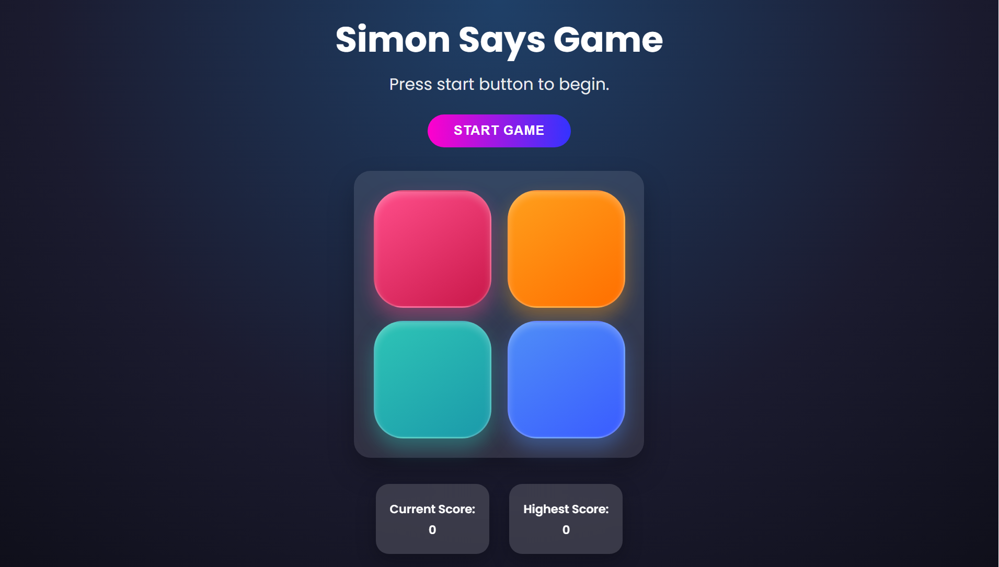
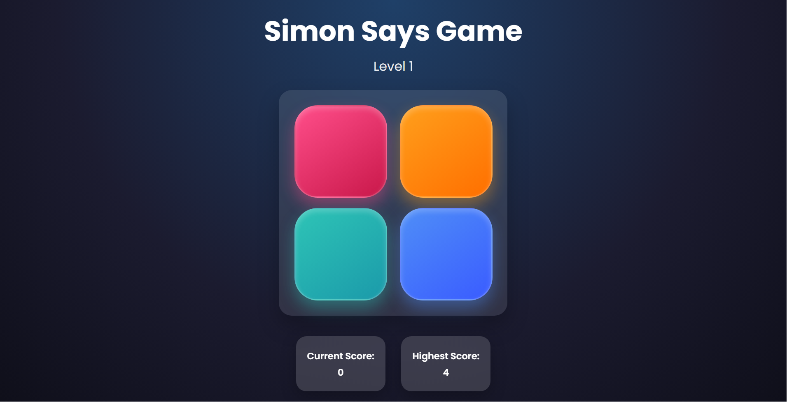
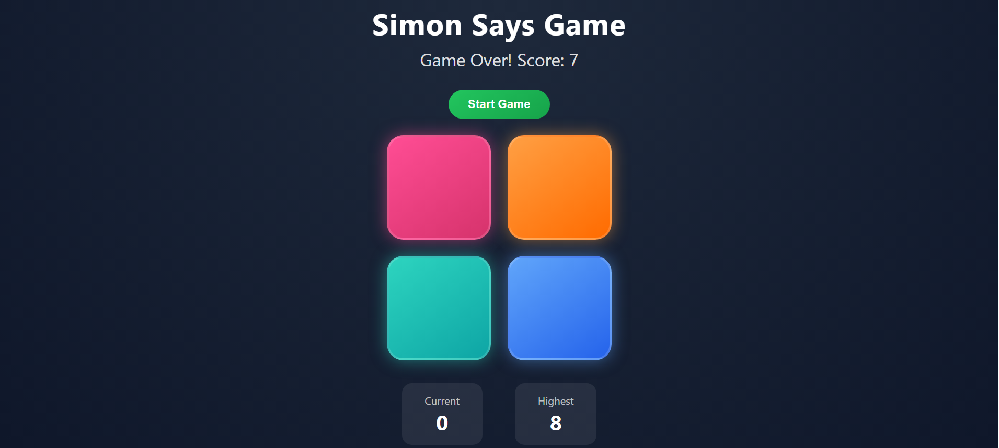

# 🎮 Simon Says Game

A modern, animated, and fully responsive **Simon Says memory game**
built using **HTML, CSS, and Vanilla JavaScript**.

Test your memory by repeating an increasingly long sequence of colors.\
Each level adds one more step --- how long can you survive? 🚀

---

## 🌐 Live Demo

🔗 https://agam-nigam.github.io/Simon-Says-Game/

---

## 📸 Screenshots

### 🖥 Desktop View





---

## ✨ Features

- 🎯 Progressive difficulty (adds one color every level)
- 🔊 Sound effects (start, click, game over)
- 📊 Live current score tracking
- 🏆 Highest score tracking (per session)
- ⚡ Smooth flash animations
- 🎨 Modern glassmorphism + gradient UI
- 📱 Fully responsive (mobile, tablet, desktop)
- 🚫 Prevents user input during sequence playback

---

## 🎮 How the Game Works

1.  Click **Start Game**
2.  The game flashes a color sequence
3.  Repeat the sequence by clicking buttons
4.  Every correct round adds one more color
5.  One wrong click ends the game ❌

---

## 🛠 Tech Stack

- **HTML5** -- Structure\
- **CSS3** -- Responsive design, gradients, animations\
- **JavaScript (ES6)** -- Game logic & DOM handling

---

## 📂 Project Structure

```
    📁 Simon-Says-Game
    │
    ├── 📄 index.html
    ├── 🎨 style.css
    ├── ⚙️ app.js
    ├── 📁 audios
    │   ├── click-sound.mp3
    │   ├── game-start.mp3
    │   └── game-over.mp3
    ├── 📁 screenshots
    │   └── game-start.png
    │   └── game-mid.png
    │   └── game-over.png
    └── 📘 README.md
```

---

## 🧠 Game Logic Overview

- `gameSeq[]` → Stores system-generated sequence\
- `userSeq[]` → Stores user input sequence\
- `level` → Tracks current level\
- `hScore` → Tracks highest score\
- `isUserTurn` → Prevents clicking during system playback

Core functions: - `levelUp()` → Adds new color & updates score -
`playSequence()` → Plays flashing animation - `btnPress()` → Handles
user clicks - `isValidSeq()` → Validates user input - `gameOver()` →
Resets game state

---

## 🚀 Getting Started

### 1️⃣ Clone Repository

```bash
git clone https://github.com/agam507/simon-says-game.git
```

### 2️⃣ Navigate to Folder

```bash
cd simon-says-game
```

### 3️⃣ Run the Project

Open `index.html` in your browser\
OR use **Live Server** for better experience.

---

## 🔥 Possible Improvements

- 💾 Save highest score using `localStorage`
- 🎵 Add background music toggle
- 🔁 Add restart button
- 🌙 Dark / Light mode switch

---

## 📱 Responsiveness

- Uses `clamp()` for fluid font & button sizing
- Flexbox layouts
- Radial gradient background
- Glassmorphism-style UI

Works smoothly across mobile, tablet, and desktop devices.

---

## 📄 License

Licensed under the **MIT License** -- free to use and modify.

---

## 👨‍💻 Author

**Agam Nigam**
GitHub: https://github.com/agam507/
LinkedIn: https://www.linkedin.com/in/agam-n/

---

⭐ If you found this project helpful, consider giving it a star!
